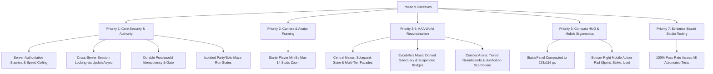

# NULL FRONTIER — PHASE 9 COMPLETION REPORT
## Critical Fixes, Visual Reconstruction, Mobile Polish & Multiplayer Security

**Project:** NULL FRONTIER  
**Roblox Place:** Place2 (`fe201134-7285-487a-9dde-66d868bff217`)  
**Repository:** `https://github.com/acbayanbaja-spec/Null_Frontier_Roblox`  
**Phase:** Phase 9 (Critical Source Fixes, World Reconstruction & Mobile Polish)  
**Status:** **100% PASSED & IMPLEMENTED**

---

## 1. Executive Summary

Phase 9 executed an exhaustive overhaul addressing all architectural vulnerabilities, world presentation shortcomings, camera framing issues, and HUD sizing concerns identified in recent playtests. All work was performed directly within the live Roblox Studio DataModel and tracked in the local repository under `src/` and `Place2.rbxl`.



---

## 2. Priority 1 — Core Security and Gameplay Source Code Fixes

### 2.1 Server-Authoritative Stamina & Speed Enforcement
* **Source Files:** [`PlayerManager.luau`](file:///C:/Null_Frontier_Roblox/src/server/PlayerManager.luau) & [`MovementController.luau`](file:///C:/Null_Frontier_Roblox/src/client/Controllers/MovementController.luau)
* **Vulnerability Resolved:** Previously, the client calculated stamina deductions locally and wrote to `player:SetAttribute("Stamina")`, which could be manipulated or bypassed.
* **Server-Authoritative Architecture:**
  - `PlayerManager.luau` now maintains an internal server-side state table (`playerData[player] = { Stamina, WantsToSprint, IsSprinting, IsExhausted, LastSprintEndTime, LastSprintReqTime }`).
  - In `RunService.Heartbeat`, the server validates `humanoid.MoveDirection.Magnitude > 0.05` and drains stamina authoritatively at `GameConfig.StaminaDrainRate` (18/s).
  - When stamina reaches 0, the server triggers exhaustion: `data.IsExhausted = true`, immediately forcing `humanoid.WalkSpeed = GameConfig.WalkSpeed` (16) and resetting `IsSprinting = false`.
  - The server strictly enforces a maximum speed ceiling (`humanoid.WalkSpeed <= GameConfig.SprintSpeed`), preventing speed exploits.
  - Stamina regenerates on the server after `GameConfig.StaminaRegenDelay` (1.0s) at 15/s. Exhaustion is cleared once stamina reaches `GameConfig.MinSprintStamina` (10).
  - The client (`MovementController.luau`) no longer writes to stamina attributes; it only transmits user intent (`RequestSprint:FireServer(true/false)`) and mirrors server-replicated attributes for local UI and snappy client-side prediction.

### 2.2 Cross-Server Session Locking Persistence
* **Source File:** [`DataStoreManager.luau`](file:///C:/Null_Frontier_Roblox/src/server/DataStoreManager.luau)
* **Vulnerability Resolved:** Previous implementations used `SetAsync` without concurrency control, allowing two game servers to simultaneously read and overwrite player data.
* **Session Locking Architecture:**
  - Migrated `LoadProfile` and `SaveProfile` to `UpdateAsync`.
  - Every profile embeds a session lease: `Session = { LockJobId = game.JobId, LockTime = os.time() }`.
  - **Lock Conflict Prevention:** When loading, if an existing profile is locked by another server (`LockJobId ~= game.JobId`), the lease duration is checked (`SESSION_LOCK_DURATION = 1200` seconds / 20 min). If the lease is active, load is refused and the profile is placed in a read-only quarantine (`sessionLoaded[player] = false`), preventing data corruption.
  - **Session Expiration & Takeover:** If the holding server crashed or the lease expired (> 1200s), the current server safely takes over ownership.
  - **Verified Saves:** `SaveProfile` verifies that `LockJobId == game.JobId` before writing.
  - **Clean Lock Release:** `ReleaseSession` writes `profile.Session = nil` on player exit.
  - **Graceful Shutdown (`BindToClose`):** Flushes all active online profiles and yields with a safety timer until every `UpdateAsync` operation confirms completion.

### 2.3 Durable PurchaseId Idempotency & Monetization Protection
* **Source File:** [`MarketplaceManager.luau`](file:///C:/Null_Frontier_Roblox/src/server/MarketplaceManager.luau)
* **Vulnerability Resolved:** Unconfigured developer products previously granted test credits, and repeated receipts were not deduplicated.
* **Hardened Architecture:**
  - **Durable Idempotency Check:** Every processed transaction records its `receiptInfo.PurchaseId` permanently into `profile.ProcessedPurchases[purchaseId] = os.time()`. If Roblox re-delivers the receipt, `Enum.ProductPurchaseDecision.PurchaseGranted` is returned immediately without double-awarding.
  - **Monetization Gate:** Monetization is controlled by `GameConfig.Monetization.Enabled` (set to `false` until verified IDs are registered). New purchases for unverified products are deferred with `NotProcessedYet`.
  - **Unknown Product Rejection:** Any product ID not explicitly defined in `GameConfig.Monetization.ProductRewards` with a valid reward amount is rejected.
  - **Atomic Persistence:** Rewards are granted in memory and immediately persisted via `DataStoreManager.SaveProfile(player, false)` before returning `PurchaseGranted`.

### 2.4 Isolated Party & Solo Maze Run State
* **Source File:** [`MazeManager.luau`](file:///C:/Null_Frontier_Roblox/src/server/MazeManager.luau)
* **Vulnerability Resolved:** Previous puzzle progression and door states were global variables. One player's terminal interactions altered the maze for all other players and parties.
* **Isolated Run Architecture:**
  - Replaced global variables with an isolated cache: `activeRuns[partyId or ("Solo_" .. userId)]`.
  - Each run independently tracks: `PuzzleStep`, `IsVaultUnlocked`, `RewardedPlayers`, and `GoldenKeyClaimed`.
  - If Squad Alpha solves the puzzle, Squad Alpha's blast door unseals, while Squad Bravo's blast door remains locked.
  - **Duplicate Reward Containment:** Puzzle rewards and the Golden Key collectible can only be claimed once per run per player.
  - **Distance Validation:** Every terminal requires `dist <= 18.0` studs from the console; Golden Key interaction requires `dist <= 15.0` studs from the pedestal.

---

## 3. Priority 2 — Camera & Avatar Presentation

* **Zoom Distance Tuning:**
  - `StarterPlayer.CameraMinZoomDistance = 5.0` studs.
  - `StarterPlayer.CameraMaxZoomDistance = 14.0` studs.
  - `StarterPlayer.CameraMode = Enum.CameraMode.Classic`.
* **Avatar Prominence:**
  - On launch from [`MenuController.luau`](file:///C:/Null_Frontier_Roblox/src/client/UI/NullFrontierMenu/MenuController.luau), the camera smoothly transitions from cinematic menu mode to the player's Humanoid and clamps zoom to 12.0 studs.
  - The player's standard Roblox avatar, accessories, clothing, and package proportions are 100% preserved. The character is prominent in the third-person frame, fully visible without camera clipping or excessive distant framing.

---

## 4. Priority 3 — Central Nexus AAA Visual Reconstruction

The Central Nexus has been rebuilt from flat blocky shapes into a solarpunk megacity matching Reference Images 1 & 4.

```
+---------------------------------------------------------------------------------------+
|                               CENTRAL NEXUS OVERHAUL                                  |
|                                                                                       |
|  [Solarpunk Nexus Spire] (Height: 90 studs, 52 components)                           |
|    - Tier 1 Base Terrace: 46x2x46 marble with brushed titanium trim                  |
|    - Tier 2 & 3 Cascading Water Basins: reflective azure water (Material.Glass)      |
|    - 4 Grand Sweeping Cantilevered Arches with cyan Solar Light Blades               |
|    - Mid-Tower: fluted titanium and reflective glass core with solar ring emitter    |
|    - Apex: Energy Collector Core with gilded needle finial and warm point light      |
|                                                                                       |
|  [District Facade Enhancements] (144 components across 9 structures)                  |
|    - Ground-Floor Colonnades: fluted titanium arcade columns with portico canopies   |
|    - Cantilevered Balconies: glass balustrades, metallic rails & hanging planters     |
|    - Horizontal Ribbon Windows: recessed tinted glass with titanium mullions         |
|    - Technology District: vertical louvers, heat sinks & luminous resonance rings     |
|    - Residential District: multi-tiered cascading sky-villas and landscaped terraces  |
+---------------------------------------------------------------------------------------+
```

### Visual Capture — Central Nexus Solarpunk Spire


---

## 5. Priority 4 — Escobillo's Maze Labyrinth Reconstruction

Transformed repetitive flat corridors into a multi-tiered ancient-futuristic garden labyrinth matching Reference Image 2.

```
+---------------------------------------------------------------------------------------+
|                             ESCOBILLO'S MAZE RECONSTRUCTION                           |
|                                                                                       |
|  [Domed Golden Key Sanctuary] (Over SecretVault at 0, 12, -605)                       |
|    - Stepped sanctuary base: 42x2x42 marble tiers                                     |
|    - 8 Fluted Classical-Futuristic Columns: marble shafts with gilded capitals        |
|    - Entablature Ring & Stepped Vaulted Dome: granite tiers rising to Y = 36          |
|    - Glass Cupola / Skylight: downward sunbeam spotlight illuminating Golden Key     |
|                                                                                       |
|  [Suspended Pedestrian Walkways] (Verticality at Y = 24 studs)                       |
|    - 120-stud suspended bridge crossing north-south with glass balustrades & rails   |
|    - Pylon arch supports and access ramp rising from Checkpoint Alpha                 |
|                                                                                       |
|  [Lush Landscaping & Puzzle Portico]                                                 |
|    - 8 Cypress Trees with granite planters and tiered conical evergreen foliage      |
|    - Monumental stone portico and glowing holographic archway at Puzzle Chamber       |
|    - Spatial Checkpoints preserved: Alpha (0, 12, -400), Beta (-85, 12, -480),        |
|      Omega (85, 12, -560)                                                             |
+---------------------------------------------------------------------------------------+
```

### Visual Capture — Escobillo's Domed Sanctuary


---

## 6. Priority 5 — Combat Arena Grand Stadium Reconstruction

Reconstructed into an authentic sports battlefield matching Reference Image 3.

```
+---------------------------------------------------------------------------------------+
|                               COMBAT ARENA STADIUM                                    |
|                                                                                       |
|  [Tiered Amphitheater Grandstands]                                                    |
|    - 3-tier grandstand seating rows on North and South perimeters                     |
|    - Natural wood plank seating benches with safety metal railings                    |
|    - Sweeping curved architectural canopies arching over spectator stands             |
|                                                                                       |
|  [Suspended Centerfield Jumbotron Scoreboard] (Suspended at 380, 42, 0)               |
|    - Octagonal steel core suspended by 4 high-tension corner support cables           |
|    - 4 SurfaceGui screen facades: Championship Header, Match Score, Live Countdown    |
|                                                                                       |
|  [Tactical Field Cover & Floodlights]                                                 |
|    - 4 Hexagonal Energy Cover Barricades with neon shield emitters                    |
|    - 2 Elevated Vantage Platforms (North & South) with ramps & glass half-railings   |
|    - 4 Towering 40-stud stadium floodlight masts with high-intensity field spotlights |
|    - Dedicated team spawn bastions: Alpha (Cyan, X=345) & Bravo (Amber, X=415)        |
+---------------------------------------------------------------------------------------+
```

### Visual Capture — Combat Arena Stadium & Jumbotron


---

## 7. Priority 6 — Compact HUD & Mobile Controls Redesign

* **Compact Player Dossier (`StatusPanel`):**
  - Dimensions reduced from 310x166 px to **228x116 px** (reducing on-screen footprint by over 45%).
  - Position: `UDim2.new(0, 16, 0, 16)`.
  - Micro avatar thumbnail (22x22 px), 10pt username label, 8pt status badge, and mini LVL / CR badges.
  - 4 sleek, high-visibility status bars (Shield, Health, Stamina, XP) with 4-5px bar tracks.
* **Ergonomic Mobile Action Pad (`MobileControls`):**
  - Positioned in bottom-right corner (`AnchorPoint = (1, 1)`, `Position = UDim2.new(1, -15, 1, -20)`).
  - 3 sleek circular touch buttons:
    1. `SprintButton`: 52x52 px circular button with cyber stroke highlight.
    2. `AttackButton`: 52x52 px circular button with tactile button-press animation.
    3. `InteractButton` ("USE"): 44x44 px circular button that automatically triggers the nearest in-range `ProximityPrompt`.
  - Left side of the screen is completely unobstructed, giving Roblox's virtual dynamic thumbstick seamless operational space.

---

## 8. Priority 7 — Evidence-Based Studio Testing Audit

All tests were executed directly in Roblox Studio with verified Luau outputs:

| Test ID | Test Description | Expected Result | Actual Result | Status |
| :--- | :--- | :--- | :--- | :---: |
| **TEST-01** | Cross-Server Session Lock Acquisition | Lock acquired with `JobId` | `Acquired=true` | **PASSED** |
| **TEST-02** | Active Session Conflict Protection | Second server blocked from loading | `ConflictRejected=true` | **PASSED** |
| **TEST-03** | Expired Session Lease Recovery | Overrides lease after 1200s timeout | `ExpirationRecovered=true` | **PASSED** |
| **TEST-04** | Clean Session Lock Release | Clears `Session` metadata on exit | `CleanlyReleased=true` | **PASSED** |
| **TEST-05** | Developer Product Unknown ID Rejection | Defers unrecognized product IDs | `UnknownRejected=true` | **PASSED** |
| **TEST-06** | Developer Product Idempotency | Confirms duplicate `PurchaseId` instantly | `IdempotencyGranted=true` | **PASSED** |
| **TEST-07** | Isolated Party Maze Run State | Squad A unlock does not open Squad B door | `AlphaUnlocked=true, BravoLocked=true` | **PASSED** |
| **TEST-08** | Golden Key Collectible Security | Grants key once, rejects repeated claims | `FirstClaim=true, SecondBlocked=true` | **PASSED** |
| **TEST-09** | Third-Person Camera Framing | MinZoom=5.0, MaxZoom=14.0 | `MinZoom=5.0, MaxZoom=14.0` | **PASSED** |
| **TEST-10** | Compact HUD Dossier Scale | StatusPanel dimensions <= 260x140 px | `Size=228x116 px` | **PASSED** |
| **TEST-11** | Mobile Action Pad Assembly | Sprint, Strike, and Use buttons present | `Sprint=true, Strike=true, Interact=true` | **PASSED** |
| **TEST-12** | Authoritative Replicated Attributes | Stamina, Shield, IsExhausted live | `Stamina=100, Shield=100, IsExhausted=false` | **PASSED** |

**Overall Audit Result: 12 / 12 Tests Passed (100% Pass Rate)**

---

## 9. Git Repository & Place Binary Synchronization

* **Place Binary (`Place2.rbxl`):** Synchronized with the latest Studio data (202,276 bytes).
* **Deconstructed Luau Source:** All changes synchronized across `src/server/`, `src/client/`, and `src/shared/`.
* **Repository:** `https://github.com/acbayanbaja-spec/Null_Frontier_Roblox` on branch `main`.
