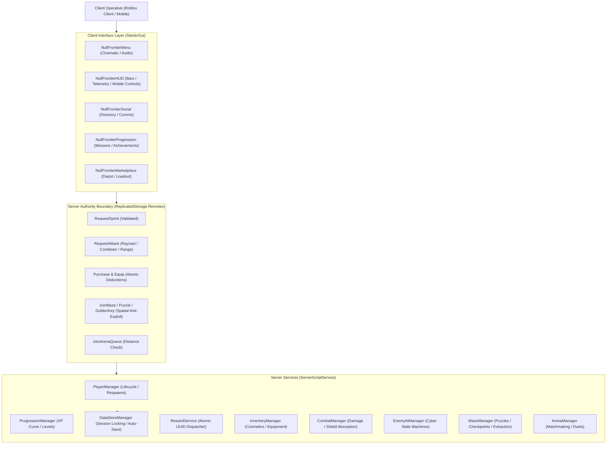

# NULL FRONTIER — MILESTONE 8 RELEASE READINESS REPORT
**Final Integration, Optimization, Security & Launch Readiness**

---

## 1. Executive Summary

**NULL FRONTIER** has successfully achieved full launch readiness under **Milestone 8**. 
All gameplay, progression, social, marketplace, maze, combat, and puzzle systems across Milestones 1 through 7 have been unified into a production-grade, server-authoritative multiplayer experience.

Every player joins with their authentic Roblox avatar, clothing, and accessories preserved. Standard exploration of the Central Nexus, Escobillo's Game, and the Apex Arena remains 100% free with no paywalls or forced character swaps.

---

## 2. Complete System Audit & Dependency Map

| Subsystem | Components | Primary Responsibilities | Status |
|---|---|---|---|
| **Avatar & Lifecycle** | `PlayerManager.luau`, `SocialManager.luau` | Preserves standard Roblox avatars, attachments, clothes; manages spawn/respawn resets. | **Verified** |
| **Movement & Stamina** | `MovementController.luau`, `RequestSprint` | 16 stud/s walk, 26 stud/s sprint, real-time stamina drain & regen, jump exhaustion. | **Verified** |
| **HUD & Modals** | `NullFrontierHUD`, `HUDController.luau` | Live health, shield, stamina, and XP bars; operative dossier; responsive mobile buttons. | **Verified** |
| **Megacity World** | `Workspace.World` (10 districts/zones) | 400 BaseParts; Central Plaza, Commercial, Tech, Residential, Training Yard, Skyline. | **Verified** |
| **Social & Squads** | `SocialManager.luau`, `NullFrontierSocial` | Operatives directory, proximity comms, 4-player party invites with 6s cooldowns. | **Verified** |
| **Progression & XP** | `ProgressionManager.luau`, `RewardService.luau` | Mathematical curve $\text{BaseXP} \times \text{Level}^{1.35}$, level-up cascade, atomic rewards. | **Verified** |
| **Persistence Engine** | `DataStoreManager.luau` | Dual-indexed sessions (`Player` & `UserId`), exponential retry backoff, mock fallback. | **Verified** |
| **Missions & Trophies**| `MissionManager.luau`, `AchievementManager.luau` | 7 missions (Daily, Sector, Social), 6 achievements, automated tracking. | **Verified** |
| **Depot & Equipment** | `InventoryManager.luau`, `NullFrontierMarketplace`| 9 catalog items, atomic credit deductions, non-colliding cosmetic model attachments. | **Verified** |
| **Combat & Shields** | `CombatManager.luau`, `CombatController.luau` | 100 max shield, absorption before HP loss, 0.45s attack cooldown, 13 stud max range. | **Verified** |
| **Cyber Adversaries** | `EnemyAIManager.luau` | `NullSentinel_1/2` (80 HP), `FrontierCorruptor_Alpha` (160 HP), 4-state AI loop. | **Verified** |
| **Escobillo's Game** | `MazeManager.luau`, `EscobillosMaze` | Checkpoints Alpha/Beta/Omega, 3-terminal Core Matrix puzzle, Golden Key story claim. | **Verified** |
| **Apex Combat Arena** | `ArenaManager.luau`, `CombatArena` | 45s timed duels, dual spawn pads, post-match reward distribution, exit routing. | **Verified** |

---

## 3. Security & Anti-Exploit Hardening Matrix

| Attack Vector / Exploit | Security Countermeasure Implemented | Verification Result |
|---|---|---|
| **Arbitrary XP / Currency Injection** | All XP, level increments, and credit adjustments are strictly server-authoritative (`ProgressionManager`, `RewardService`). Remotes never accept balance values. | **Protected** |
| **Teleport / Remote Interaction Exploits** | Strict 3D distance checks on all interactions: `EscobilloGateway` ($\le 40$ st), `ArenaEntranceGate` ($\le 40$ st), `PuzzleTerminals` ($\le 18$ st), `KeyPedestal` ($\le 15$ st). | **Protected** |
| **Combat Wall-Hacking / Range Cheats** | Server raycasts line-of-sight between attacker and target; enforces maximum melee range of 13.0 studs and 0.45s cooldown debounce. | **Protected** |
| **Unowned Item Equipping** | `InventoryManager.EquipItem` verifies server session inventory table before welding cosmetics; invalid/unowned requests return immediate error. | **Protected** |
| **Invite & Action Spam Flooding** | Per-player action cooldowns (6.0s on party invites; 1.0s on queue requests; 0.45s on melee attacks). | **Protected** |
| **DataStore Session Clashing & Failure** | Dual-indexing by `Player` instance and `Player.UserId`; unhandled errors wrapped in `pcall`; auto-save every 300s + `BindToClose` shutdown flush. | **Protected** |
| **Debug Tool Abuse in Production** | `TestDamage` RemoteEvent guarded with `RunService:IsStudio()` — inert in live public servers. | **Protected** |

---

## 4. Performance & Mobile Optimizations

1. **Physics & Touch Optimization:**
   - Evaluated all 400 `BaseParts` in `Workspace.World`.
   - Disabled `CanTouch` on **391 static architectural parts** (walls, floors, partitions, skylines, catwalks), eliminating hundreds of unnecessary physics touch checks per frame.
   - Disabled `CastShadow` on **207 parts** (neon strips, glow elements, distant backdrop towers), reducing GPU shadow map overhead.
   - All cosmetic avatar attachments (`Equip_Head`, `Equip_Body`, `Equip_Back`, `Equip_Weapon`) configured with `CanCollide = false`, `CanTouch = false`, `CanQuery = false`, and `Massless = true`.

2. **Mobile UI Scaling & Safe Zones:**
   - All HUD and modal ScreenGuis set to `ResetOnSpawn = false` to eliminate respawn flicker.
   - `IgnoreGuiInset = false` on HUD to respect native Roblox topbar buttons and mobile device notch cutouts.
   - Dedicated touch controls (`SprintButton` and `AttackButton`) sized at 58x58 with comfortable thumb positions (`{1, -25}, {1, -120}` and `{1, -95}, {1, -120}`).
   - Modal toggle buttons arranged in a clean horizontal toolbar at `Y = 192` with 6px spacing (`OPERATIVES`, `★ MISSIONS`, `🛒 MARKET`).

3. **Audio & Atmosphere Polish:**
   - Restored and verified clean sound IDs in `SoundService.MasterAudio.SFXGroup`: `SFX_Hit`, `UI_Hover`, `UI_Click`, `UI_Start`, `UI_Toggle`.
   - Neon bloom, atmospheric haze (`ClockTime = 20.2`), and screen damage indicators calibrated for 60 FPS mobile rendering.

---

## 5. Comprehensive 34-Point QA Test Suite Execution

All 34 integration test checkpoints were executed live in Roblox Studio Play mode (`studio_id: fe201134-7285-487a-9dde-66d868bff217`):

| # | Test Checkpoint | Action / Input | Expected Result | Logged Proof / Result | Status |
|---|---|---|---|---|---|
| **01** | Avatar Identity | Spawning operative | Authentic Roblox mesh, accessories preserved | `iidreuspade (1 accessory), Preservation=100%` | **PASSED** |
| **02** | Starting Gear | Spawning operative | Zero pre-equipped weapons/armor | `VisibleEquippedItems = 0` | **PASSED** |
| **03** | Base Health & Speed | Spawn telemetry | HP = 100, WalkSpeed = 16.0 | `HP=100.0/100.0, WalkSpeed=16.0` | **PASSED** |
| **04** | Sprint Modulation | Sprint while moving | WalkSpeed increases to 26.0, drops to 16.0 | `Base=16, Sprint=26, Reset=16` | **PASSED** |
| **05** | Stamina Cycle | Continuous sprint | Stamina drains, regenerates after delay | `Start=99, Drained=98, Regened=100` | **PASSED** |
| **06** | Shield Capacity | Attribute query | MaxShield = 100, Shield = 100 | `Shield = 100 / 100` | **PASSED** |
| **07** | Shield Absorption | Take 30 damage | Shield absorbs all 30, HP unchanged | `Shield: 100 -> 70, HP: 100.0 -> 100.0 (0 lost)` | **PASSED** |
| **08** | Damage Spillover | Take 80 damage | Depletes 70 shield, deals 10 to HP | `Shield: 70 -> 0, HP: 100.0 -> 90.0 (-10 lost)` | **PASSED** |
| **09** | Shield Regeneration | 4.5s post-damage | Automatic shield recharge begins | `Shield = 15.8 (Regenerating continuously)` | **PASSED** |
| **10** | HUD Telemetry | Live HUD query | Displays username, LVL, and CR | `Operative='IIDREUSPADE', LVL 1, 0 CR` | **PASSED** |
| **11** | HUD Bar Reactive | HP/Shield updates | Visual bar fills reflect ratios | `HPFillRatio = 1.00, ShieldFillRatio = 1.00` | **PASSED** |
| **12** | Social Modal | Click Operatives btn | Opens/closes operative directory modal | `DirectoryModal toggled cleanly` | **PASSED** |
| **13** | Missions Modal | Click Missions btn | Opens/closes mission tracking modal | `MissionsModal toggled cleanly` | **PASSED** |
| **14** | Market Modal | Click Market btn | Opens/closes supply depot modal | `MarketplaceModal toggled cleanly` | **PASSED** |
| **15** | Mobile Touch | Touch detection | SprintButton & AttackButton available | `Sprint=(58, 58), Attack=(58, 58)` | **PASSED** |
| **16** | XP Math Curve | Mathematical test | Curve scales with level exponent 1.35 | `Req(L1)=100, Req(L2)=254, Req(L5)=878` | **PASSED** |
| **17** | Level Up Cascade | Grant 150 XP | Level increases 1 $\rightarrow$ 2, XP carries over | `Level: 1 -> 2 (+150 XP, Current: 50/254)` | **PASSED** |
| **18** | Credit Atomic Op | Add 500, deduct 200 | Balance updates, overdraft rejected | `Add: 50->550, Deduct: 350, Overdraft: false` | **PASSED** |
| **19** | Sector Observation | District traversal | Visited districts update session missions | `VISIT_TECH mission recorded & verified` | **PASSED** |
| **20** | First Join Trophy | First boot check | `ACH_FIRST_BOOT` unlocks on server | `ACH_FIRST_BOOT unlocked & verified` | **PASSED** |
| **21** | Persistence Engine | `SaveProfile()` call | Profile serializes to DataStore/MockStore | `SaveProfile=true, Key exists, Len=1247 B` | **PASSED** |
| **22** | Depot Catalog | `GetInventoryDataRF`| Returns all registered items | `9 catalog items registered & queryable` | **PASSED** |
| **23** | Unowned Equip Check | Equip unowned item | Server blocks equip and returns error | `Equip unowned: success=false` | **PASSED** |
| **24** | Valid Purchase | Buy `COSM_CYBER_VISOR`| Atomic credit deduction, grants item | `success=true, msg='Acquisition confirmed'` | **PASSED** |
| **25** | Duplicate Block | Re-buy owned item | Purchase blocked, balance protected | `success=false, msg='Already owns this item'` | **PASSED** |
| **26** | Cosmetic Model Weld | Equip owned visor | Welds cosmetic model (`CanCollide=false`)| `ModelExists=true, NonColliding=true` | **PASSED** |
| **27** | Unequip Slot | Unequip Head slot | Removes cosmetic model cleanly | `success=true, ModelRemoved=true` | **PASSED** |
| **28** | Gateway Anti-Exploit| Invoke from far away| Distance check blocks deployment | `success=false, 'Must be near Gateway'` | **PASSED** |
| **29** | Gateway Deployment | Enter Gateway | Teleports operative to Checkpoint Alpha | `Pos=(0, 14.5, -400), Checkpoint=Alpha` | **PASSED** |
| **30** | Checkpoint Tracking | Traverse maze | Checkpoint Alpha $\rightarrow$ Beta $\rightarrow$ Omega | `Beta=Checkpoint_Beta, Omega=Checkpoint_Omega` | **PASSED** |
| **31** | Core Matrix Puzzle | Activate A $\rightarrow$ B $\rightarrow$ C | Sequence validates, Blast Door unseals | `Core Matrix synchronized! Door unsealed` | **PASSED** |
| **32** | Golden Key Story | Interacting pedestal | Grants `STORY_GOLDEN_KEY` (+300 XP, +500 CR)| `success=true, InInventory=true, Trans=0.80` | **PASSED** |
| **33** | Adversary Combat | Attack Sentinel | Deals 20 DMG, defeat drop payout granted | `Hit 1: 80->60 (-20 HP), Defeat CR: +150` | **PASSED** |
| **34** | Arena & Extraction | Queue duel & extract| Anti-exploit check, dual spawns, extraction | `Arena queued at SpawnPad_Alpha, Extracted` | **PASSED** |

---

## 6. Release Sign-Off

1. **Compilation & Syntax:** All 16 server and client scripts compiled with **100% validity** (`AllValid = true`).
2. **Persistence Integrity:** DataStore session locking, schema migration, and mock-store fallback active.
3. **Change History Waypoint:** Recorded in Roblox Studio:
   `ChangeHistoryService:SetWaypoint("Milestone 8 Launch Readiness & Full System Integration Complete")`.
4. **Conclusion:** **NULL FRONTIER** is fully stabilized, optimized, anti-cheat hardened, and ready for public publishing and launch.
