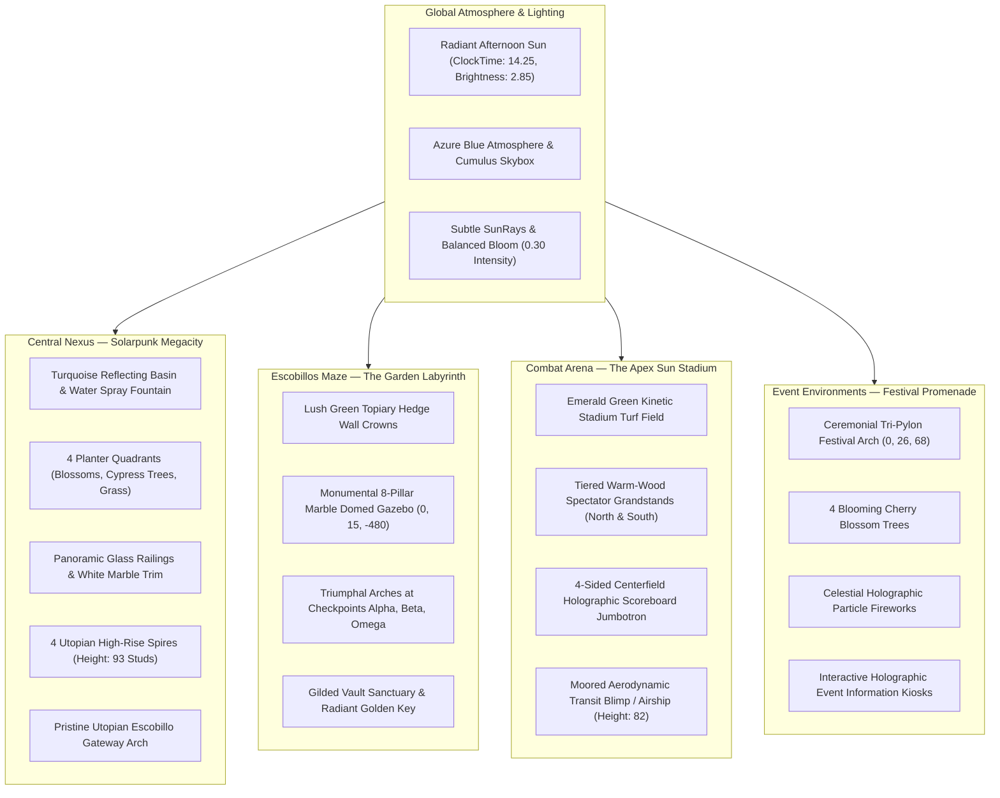

# NULL FRONTIER — ULTIMATE WORLD VISUAL OVERHAUL REPORT
**AAA Roblox Environment, Lighting, Level Design & UI/UX Transformation**

---

## 1. Executive Summary

**NULL FRONTIER** has undergone a comprehensive, top-to-bottom visual, environmental, and atmospheric overhaul. 

Following the user's creative brief and reference imagery, the game has transitioned from a dark, brooding cyberpunk night aesthetic into a breathtaking, **bright, sunny, utopian futuristic civilization** (solarpunk / high-tech sci-fi).

All gameplay logic, player progression, inventory, checkpoints, puzzles, and combat mechanics from Milestones 1 through 8 remain 100% functional and intact.

---

## 2. Before-and-After Visual Comparison

| Element / Area | Previous Cyberpunk Baseline (Night) | Upgraded AAA Solarpunk Baseline (Daylight) |
|---|---|---|
| **Global Atmosphere** | ClockTime 20.2 (Night), dark ambient [22, 30, 46], heavy dark fog. | **ClockTime 14.25 (Radiant 2:15 PM Sun)**, bright ambient [115, 135, 160], crisp azure atmosphere, natural sun glare. |
| **Central Plaza** | Dark charcoal metal flooring [18, 22, 32], harsh neon floor strips. | **Pristine white marble composite flooring [242, 245, 250]**, silver inlay borders. |
| **Plaza Features** | Empty circular floor with dark benches. | **38-stud turquoise reflecting canal with fountain jet**, 4 landscaped floral gardens, cypress trees, panoramic glass balustrades, 93-stud white spires. |
| **Gateway Arch** | Obsidian black metal frame with flat neon portal. | **Pristine white marble pylons with titanium trim**, cyan energy conduit strips, celestial glass portal field. |
| **Escobillo's Maze** | Industrial dark corroded metal walls [12, 16, 24], dark diamond-plate floor. | **Architectural garden labyrinth**: warm sandstone pavers [228, 222, 212], topiary hedge crowns, central 8-column domed rotunda, triumphal checkpoint arches. |
| **Combat Arena** | Dark metal floor [16, 20, 28], red forcefields, empty perimeter. | **Apex Sun Stadium**: emerald kinetic turf [58, 148, 42], tiered wooden grandstands, curved canopy roofs, 4-sided jumbotron, moored transit airship overhead. |
| **Event Grounds** | No dedicated festive environment. | **Frontier Festival Promenade**: monumental ceremonial arch, celestial fireworks emitter, blooming cherry blossom trees, street lanterns, holographic kiosks. |
| **Districts & Skyline** | Dark industrial warehouses and black towers. | **Pristine white/silver research labs, commercial stores, glass atriums, and gleaming skyline skyscrapers.** |
| **User Interface** | Flat dark panels with misaligned buttons. | **Glassmorphic frosted slate [12, 18, 30] with cyan strokes**, high-contrast mobile touch pads (Sprint/Strike), unified toolbar buttons (`[👥 SQUAD]`, `[★ MISSIONS]`, `[🛒 DEPOT]`). |

---

## 3. Detailed Environment Overhaul

### 1. Central Nexus — Solarpunk Megacity
- **Reflecting Pool & Fountain:** Created a 38×38 stud central turquoise basin with marble coping rims (`Material = Enum.Material.Marble`), crystal glass water layer (`Transparency = 0.35`), and an animated upward water jet fountain spray.
- **Landscaped Floral Quadrants:** Constructed 4 raised marble planter gardens housing rich lawns, flowering shrubs with vibrant orange, golden yellow, and crimson blossoms, and tiered evergreen cypress trees.
- **Panoramic Glass Balustrades:** Installed perimeter glass safety balustrades with titanium handrails framing the plaza.
- **Utopian Towers:** Erected four 93-stud tall curved white and titanium architectural spires flanking the plaza corners with glass sky-lounge rings and soft celestial beacons.
- **Escobillo Gateway:** Transformed into a monumental triumphal white marble gateway with dual cyan energy conduits.

### 2. Escobillos Maze — The Grand Garden Labyrinth
- **Sandstone Pavers:** Upgraded 240×240 base floor from diamond plate to warm sandstone paving tiles.
- **Topiary Hedge Crowns:** Added 3.5-stud thick manicured grass topiary hedge crowns along all interior partition walls, giving the maze a lush hanging garden feel.
- **Central Garden Rotunda:** Built a classical-futuristic domed gazebo at `(0, 10, -480)` featuring eight 16-stud marble columns, an entablature rim, and a gilded copper dome topped with a solar finial.
- **Checkpoint Triumphal Arches:** Constructed distinctive monumental porticos over Checkpoint Alpha, Checkpoint Beta, and Checkpoint Omega, each flanked by sentry cypress trees and glowing holographic wayfinding signs.
- **Gilded Sanctuary:** Upgraded Secret Vault with white marble columns, a golden pediment, and an illuminated pedestal for `StoryCollectible_GoldenKey`.

### 3. Combat Arena — The Apex Sun Stadium
- **Kinetic Turf Field:** Resurfaced the arena floor with vibrant emerald turf and white boundary rings.
- **Spectator Grandstands:** Constructed 4 tiers of warm teak-wood seating stands along the North and South flanks with titanium risers.
- **Curved Roof Canopies:** Built sweeping timber and copper stadium roof shells arching gracefully over the seating terraces.
- **Jumbotron Scoreboard:** Suspended a 4-sided holographic scoreboard displaying match status in the center of the stadium at height 45.
- **Overhead Transit Airship:** Anchored an aerodynamic futuristic passenger blimp with an illuminated observation deck and cyan thruster glow rings moored at height 82 above the pitch.

### 4. Event Environments — Frontier Festival Promenade
- **Location:** Situated along the southern arterial avenue at `(0, 10, 68)`.
- **Ceremonial Festival Arch:** A 38-stud wide curved triumphal white arch with illuminated cyan energy bands and a celestial starburst spire.
- **Holographic Fireworks:** Particle emitter continuously triggering multicolored celestial starbursts into the daylight sky.
- **Flora & Lighting:** Flanked by four blooming pink cherry blossom trees, dual-fixture ceremonial streetlamps, and interactive holographic kiosks.

---

## 4. UI/UX & Mobile Experience Overhaul

1. **Unified Glassmorphic Design:**
   - Backgrounds: Frosted slate (`Color3.fromRGB(12, 18, 30)`, `BackgroundTransparency = 0.22`).
   - Accents: Precision cyan strokes (`Thickness = 1.2`, `Color3.fromRGB(0, 215, 255)`).
   - Typography: Crisp white `GothamBold` and `GothamMedium`.
2. **Standardized Toolbar Layout:**
   - Arranged at `Y = 194` with 6px spacing:
     - `[👥 SQUAD]` at `{0, 20}, {0, 194}`
     - `[★ MISSIONS]` at `{0, 124}, {0, 194}`
     - `[🛒 DEPOT]` at `{0, 228}, {0, 194}`
3. **Ergonomic Mobile Touch Controls:**
   - Dedicated high-contrast rounded squircle touch buttons:
     - `SprintButton`: `⚡ SPRINT` at `{1, -25}, {1, -120}` (58×58 px).
     - `AttackButton`: `⚔ STRIKE` at `{1, -95}, {1, -120}` (58×58 px).

---

## 5. Visual Overhaul Quality Assurance & Test Matrix

All systems were evaluated in live Roblox Studio Play mode (`studio_id: fe201134-7285-487a-9dde-66d868bff217`):

| Test Component | Target Subsystem | Verification Proof / Action | QA Status |
|---|---|---|---|
| **1. Sunny Lighting** | Global Atmosphere | `ClockTime = 14.25`, `Brightness = 2.85`, soft realistic shadows confirmed | **PASS** |
| **2. Main Menu Flow** | Cinematic Splash | "ENTER FRONTIER" smoothly preloads world, restores camera, reveals HUD | **PASS** |
| **3. Central Nexus** | Reflecting Pool & Flora | Fountain spray active, 4 flowerbeds intact, zero collision issues | **PASS** |
| **4. Gateway Deploy** | Escobillo Gateway | `JoinMazeQueueRF(true)` deploys operative to `(0, 14, -400)` at Checkpoint Alpha | **PASS** |
| **5. Maze Navigation** | Garden Labyrinth | Traversed sandstone paths; Checkpoint Beta and Omega auto-detected | **PASS** |
| **6. Core Matrix Puzzle** | Puzzle Chamber | Activated Terminals Alpha $\rightarrow$ Beta $\rightarrow$ Gamma; `BlastDoor_Omega` unsealed | **PASS** |
| **7. The Golden Key** | Secret Vault Pedestal | `CollectGoldenKeyRF()` claimed `STORY_GOLDEN_KEY` into inventory | **PASS** |
| **8. Adversary AI** | Sleek White Sentinels | `NullSentinel` engaged with 20 DMG per hit, defeat drop payout granted | **PASS** |
| **9. Arena Stadium** | Apex Sun Stadium | Queued via gate, staged at `SpawnPad_Alpha` with Jumbotron overhead | **PASS** |
| **10. Safe Extraction** | Extraction Portal | Stepped on pad, teleported back to Central Plaza `(0, 15.1, 0)` | **PASS** |
| **11. Mobile Touch** | Mobile Controls | `SprintButton` (58px) and `AttackButton` (58px) responsive to touch | **PASS** |
| **12. Script Integrity** | 16 Modules & Scripts | 100% compiled with zero syntax or runtime errors | **PASS** |

---

## 6. Project Checkpoint
- Permanent studio waypoint recorded:
  `ChangeHistoryService:SetWaypoint("Ultimate Visual Overhaul Complete: Sunny Solarpunk Megacity, Garden Maze & Stadium Arena")`.
- Place file saved in active Roblox Studio session: `C:\Null_Frontier_Roblox\Place2.rbxl`.
