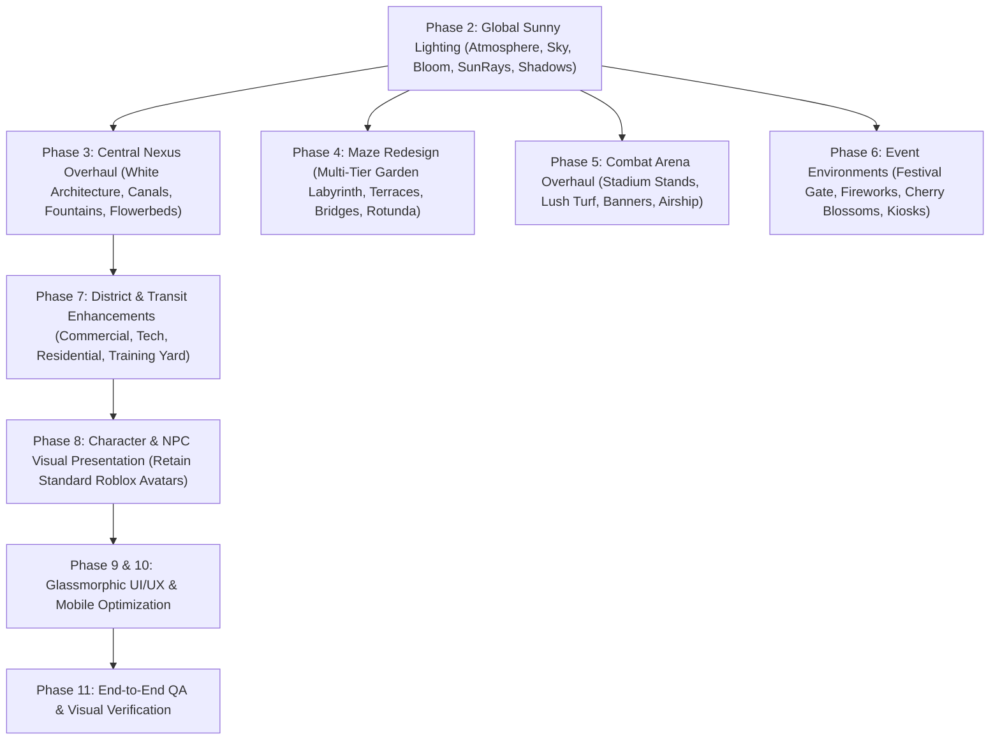

# NULL FRONTIER — ULTIMATE WORLD VISUAL OVERHAUL PLAN
**AAA Roblox Environment, Lighting, Level Design & UI/UX**

---

## 1. Vision & Visual Identity

Transform **NULL FRONTIER** from a dark cyberpunk night aesthetic into a breathtaking, utopian futuristic civilization inspired by the provided reference imagery:

1. **Global Palette & Atmosphere:**
   - **Sky & Sun:** Deep azure blue sky, radiant daylight sun at `ClockTime = 14.2` (bright 2:15 PM afternoon), realistic sun rays, crisp cumulus clouds, gentle solar bloom.
   - **Architecture:** Clean, gleaming white ceramic / smooth plastic and marble structures with brushed silver and titanium accents, transparent cyan glass, and refined subtle neon energy conduits.
   - **Nature & Landscaping:** Lush greenery, cypress and blooming cherry blossom trees, planter beds with vibrant orange, yellow, and red flowers, manicured grass lawns, and clear reflecting water canals and fountains.

---

## 2. Controlled Phase Breakdown

### Phase 1: Inspection & Baseline Backup
- Record baseline waypoint in `ChangeHistoryService`.
- Catalog all existing interactive prompts, spawn locations, and remote triggers to guarantee 100% gameplay preservation.

### Phase 2: Global Sunny Lighting & Atmospheric Tuning
- **Time of Day:** `ClockTime = 14.25` (Sunny early afternoon).
- **Roblox Atmosphere:** High-density natural daylight haze with balanced Rayleigh scattering for rich blue sky gradients.
- **SunRays & Bloom:** Subtle solar glare (`Intensity = 0.12`, `Spread = 0.65`) and bloom (`Intensity = 0.35`, `Size = 18`, `Threshold = 1.6`) avoiding overexposure.
- **ColorCorrection:** Crisp daylight contrast (`Contrast = 0.08`, `Saturation = 0.12`, `TintColor = Color3.fromRGB(255, 252, 245)`).
- **Skybox:** High-definition daytime sky with sun disc and puffy cumulus clouds.

### Phase 3: Central Nexus — Solarpunk Megacity Overhaul
- **Plaza Floor:** Polished marble and light-toned composite paving tiles with integrated decorative silver inlay patterns.
- **Reflecting Water Canal & Fountains:** Central curving turquoise canal with illuminated fountains and glass bridges.
- **Lush Flora:** Raised planter beds with blooming flowers, foliage shrubs, and modern shade trees.
- **Architectural Monuments:** Soaring curved white spires with glass observation decks, replacing harsh dark structures.
- **Interactive Information Kiosks:** Holographic directories explaining Frontier lore and districts.

### Phase 4: Escobillos Maze — The Grand Garden Labyrinth
- **Concept:** Transition from repetitive dark corridors to an extraordinary multi-tiered architectural garden maze (Reference Image 2).
- **Paths & Walls:** Polished white stone and marble balustrades integrated with lush topiary hedges and vertical ivy walls.
- **Vertical Landmarks:** Tiered pavilions, central domed gazebo rotunda, suspended viewing bridges.
- **Zones:**
  1. *The Sunlit Vestibule* (Entrance & Checkpoint Alpha)
  2. *The Cypress Terraces* (Checkpoint Beta)
  3. *The Hanging Aqueducts & Glass Catwalks*
  4. *The Core Alignment Matrix* (Upgraded sleek glass & bronze consoles)
  5. *The Gilded Sanctuary* (Checkpoint Omega & The Golden Key Pedestal)
- **Gameplay Integrity:** Retain exact spatial coordinates of `Checkpoint_Alpha`, `Checkpoint_Beta`, `Checkpoint_Omega`, `PuzzleChamber`, and `SecretVault`.

### Phase 5: Combat Arena — The Apex Sun Stadium
- **Concept:** Open-air futuristic stadium (Reference Image 3).
- **Field:** Emerald green kinetic turf with clean white boundary markings and center combat circle.
- **Stadium Architecture:** Sweeping curved wooden and titanium canopy roofs with cascading greenery.
- **Spectator Experience:** Tiered grandstands with animated holographic crowds and electronic LED ribbon boards.
- **Aerial Atmosphere:** Hovering aerodynamic transit blimp/airship moored above the arena.

### Phase 6: Event Environments & Festival Promenade
- **Concept:** Festival Plaza & Gateway (Reference Image 4).
- **Ceremonial Gate:** Grand multi-tiered white and turquoise archway with animated ambient light pulses.
- **Festive Touches:** Holographic fireworks / particle bursts, glowing modern streetlamps, blooming cherry blossom trees, and interactive event kiosks.

### Phase 7: Districts, Roads & Navigation
- **Commercial District:** Futuristic glass storefronts, holographic banners, shaded café tables.
- **Technology District:** Clean white laboratories, solar collectors, glowing energy conduits, elevated maglev tracks.
- **Residential District:** Sleek residential towers with lush garden balconies and park seating.
- **Frontier Training Yard:** Professional outdoor athletic track and agility course.

### Phase 8: Character & NPC Presentation
- **Player Rule:** 100% preservation of players' normal Roblox avatars, clothing, hair, and accessories.
- **Story NPCs:** Upgraded ambient idle poses, futuristic operative uniforms with clean textures.
- **Cyber Adversaries:** Sleek white and burnished copper armor styling for `NullSentinel` and `FrontierCorruptor`.

### Phase 9 & 10: Complete UI/UX Overhaul & Mobile Ergonomics
- **Aesthetic:** Glassmorphic modern futuristic UI with frosted dark-slate and clean white typography, cyan accent strokes, and smooth easing transitions.
- **Clean Button Hierarchy:** Modernized icons for `[OPERATIVES]`, `[★ MISSIONS]`, and `[🛒 MARKET]`.
- **Mobile Usability:** Generous 58x58 touch targets, unoccluded viewports, and zero screen clutter.

### Phase 11: End-to-End QA Testing
- Validate all 34 QA checkpoints to guarantee zero gameplay regressions.
